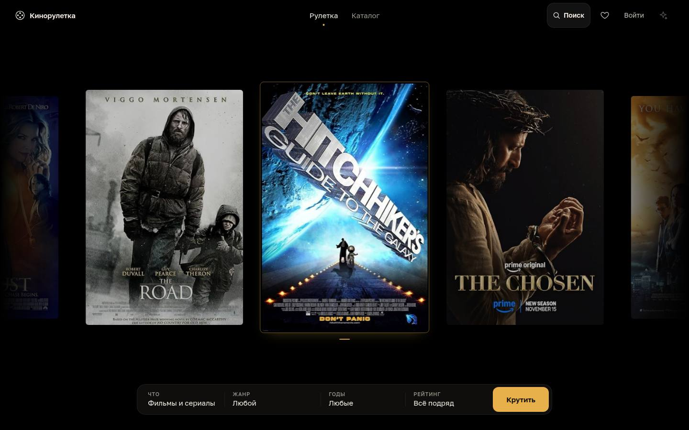
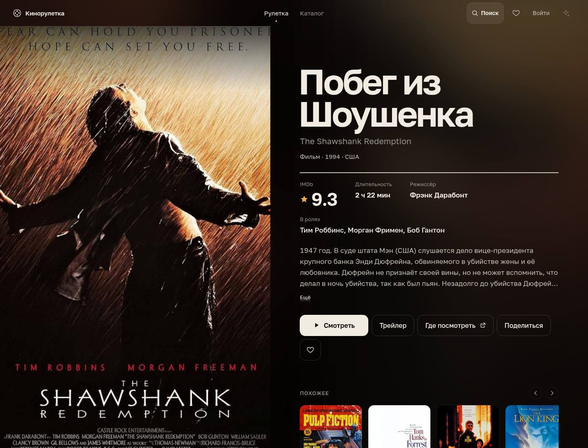
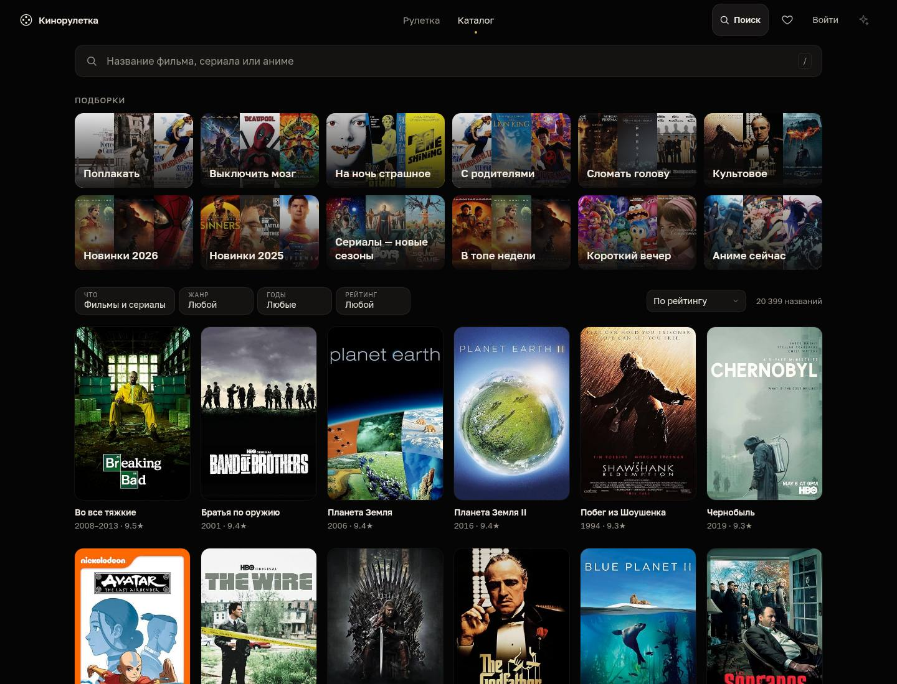

# Кинорулетка

Случайный фильм, сериал или аниме на вечер. Выбираешь, что крутить, жмёшь «Крутить» и получаешь карточку: постер, описание, трейлер и где смотреть.

Сайт: [relocpe.github.io/kino-roulette](https://relocpe.github.io/kino-roulette/)

## Как пользоваться

1. На главной задай «Что», жанр, годы и рейтинг. В том же окне есть регион, длительность и «только с русским названием».
2. «Крутить» гоняет ленту и открывает карточку.
3. «Смотреть» ищет плеер. «Трейлер» открывает ролик. «Поделиться» отправляет ссылку или картинку для сторис.
4. Под кнопкой лежит лента «Недавние»: один клик возвращает прошлый спин.
5. Каталог собирает подборки. Списки «Любимые» и «Просмотрено» после входа сохраняются на сервере.

Настройки, история спинов и уже выпавшие названия лежат в браузере (`kr:prefs`, `kr:hist`, `kr:seen`).

## Локально

Нужен любой статический сервер из корня проекта:

```bash
python3 -m http.server 4173
```

Открой `http://127.0.0.1:4173/`. Проверки: `npm test`.

## Экраны

Главная с барабаном и пультом.



Карточка после спина: крупный постер, описание и кнопки.



Каталог и подборки.


